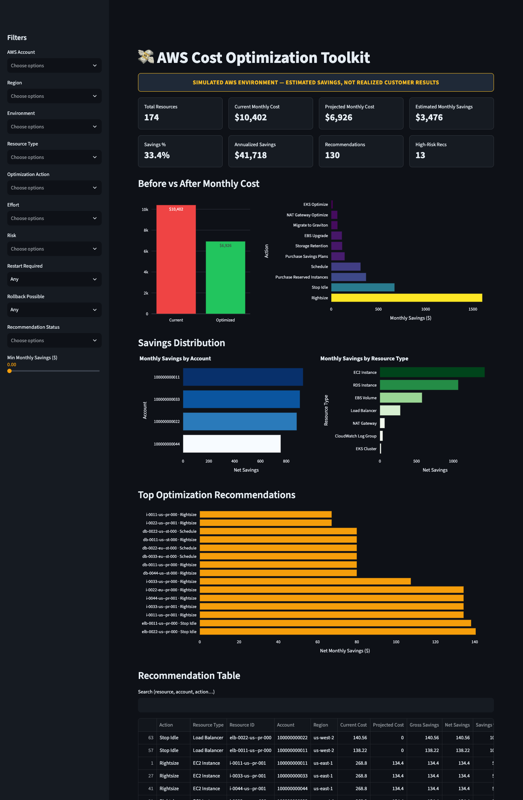

# AWS Cost Optimization Toolkit

A Python-based AWS FinOps dashboard that analyzes infrastructure utilization,
identifies rightsizing and idle-resource opportunities, and models potential
savings across a synthetic multi-account AWS environment.

> **This is a portfolio demonstration using synthetic AWS data. The savings are
> modeled estimates, not verified customer savings. Live AWS collectors are not
> yet implemented.** This project never connects to any AWS account.

---

## Dashboard



## What it demonstrates

- **Multi-account + multi-region filtering** (4 fictional accounts, 3 regions)
- **10 optimization actions:** rightsize, stop-idle, schedule, EKS optimize,
  EBS upgrade, Savings Plans, Reserved Instances, Graviton migration, NAT
  optimize, and storage/log retention
- **Recommendation deduplication** so overlapping actions are never double-counted
- **Operational risk** (effort, risk, restart, rollback, confidence) per recommendation
- **Four-stage savings pipeline:** gross → actionable → approved → realized,
  separated from *financial classification* (estimated vs. verified)
- **Evidence-gated rules:** a missing metric blocks a recommendation; it is never
  treated as zero usage
- **Interactive dark-themed Streamlit dashboard** with KPI strip, before/after
  comparison, category/account/resource-type breakdowns, top recommendations,
  a searchable table, and CSV export

### Demo headline numbers (synthetic, computed — not hardcoded)

| Metric | Value |
|---|---|
| Baseline monthly cost | **$10,402** |
| Projected optimized cost | **$6,926** |
| Estimated monthly savings | **$3,476** |
| Savings percentage | **33.4%** |
| Annualized potential | **$41,718** |
| Recommendations | 130 |

These figures are produced by the engine from documented pricing assumptions
(`docs/pricing-assumptions.md`). No value is hardcoded to hit a target.

## How recommendations are calculated

1. The **synthetic provider** (`src/costtk/providers/sample.py`) generates a
   deterministic multi-account, multi-region inventory with per-resource
   utilization, ownership, and pricing attributes.
2. **One rule per action type** (`src/costtk/engine/rules/`) inspects resources
   and emits a candidate recommendation **only when sufficient evidence is
   present**. A missing metric blocks a recommendation — it is never treated as
   zero usage, and ownership/evidence insufficiencies gate emissions.
3. **Classification** tags each recommendation with effort, risk, restart
   requirement, and rollback feasibility.
4. **Savings** are computed as `current − projected` from documented pricing
   assumptions (e.g. Graviton ≈ 20% cheaper, Savings Plans ≈ 28%, RIs ≈ 42%).

## How overlapping savings are handled (deduplication)

Overlapping recommendations on the same resource are **never summed**. Physical
changes (stop-idle, rightsize, graviton, schedule) are mutually exclusive — the
highest-confidence survivor is kept and the rest are dropped (recorded as
`deduped_from`). Commitments (Savings Plans, Reserved Instances) are then
**re-based** against the reduced physical footprint rather than stacked on the
pre-change cost. See `docs/risk-methodology.md` for the precedence rules.

## AWS integration status

| Component | Status |
|---|---|
| Synthetic provider (demo) | ✅ Functional — default data source |
| Live boto3 collectors | ⚠️ **Stub / not implemented** — no live collectors exist |
| Read-only IAM policy example (`data/iam-policy.json`) | ✅ Provided (descriptive/get APIs only) |
| `collect_aws.py` entrypoint | ✅ Guard — refuses to run without explicit double opt-in |

The demo, tests, and CI never call AWS. Live collection must be explicitly
enabled (`COSTTK_COLLECTOR=live COSTTK_READ_ONLY=1`) and is documented as
incomplete.

---

## Installation

Requires Python ≥ 3.10 (developed on 3.12).

```bash
git clone <this-repo> && cd aws-cost-optimization-toolkit
python3 -m venv .venv
source .venv/bin/activate
pip install -e ".[dev]"          # installs runtime + dev (pytest, ruff)
```

## Run the demo

```bash
# 1. (optional) regenerate the synthetic dataset + recommendations
python scripts/generate_sample_data.py

# 2. launch the dashboard
streamlit run app/dashboard.py
```

Open the printed local URL. Everything runs offline; no AWS credentials are
read, and no boto3 client is constructed on the demo path.

## Run the tests & lint

```bash
pytest -q          # 33 tests
ruff check src tests
```

## Export a CSV report

```bash
python -c "import sys; sys.path.insert(0,'src'); \
from costtk.engine.engine import RecommendationEngine; \
from costtk.providers.sample import SyntheticProvider; \
from costtk.export.csv import write_recommendations_csv; \
r = RecommendationEngine(SyntheticProvider(seed=42)).analyze(); \
write_recommendations_csv(r.recommendations, 'reports/recommendations-sample.csv')"
```

A sample export is committed at `reports/recommendations-sample.csv`.

---

## Repository structure

```
src/costtk/
  models.py           dataclasses + enums (Resource, Recommendation, states)
  config.py           env gating (synthetic by default)
  providers/          base ABC + synthetic provider (live collectors not implemented)
  engine/
    rules/            one generator per action type
    classify.py       effort/risk/restart/confidence
    dedupe.py         overlap collapse (no double-count)
    savings.py        four-stage ledger + financial classification
    engine.py         orchestrator
  export/csv.py       CSV serialization
app/dashboard.py      Streamlit dashboard
scripts/              generate_sample_data.py · collect_aws.py (opt-in guard)
data/iam-policy.json  least-privilege read-only IAM example
tests/                pytest suite
docs/                 architecture · pricing · risk · security
```

---

## Documentation

- [`docs/architecture.md`](docs/architecture.md) — architecture + data flow
- [`docs/pricing-assumptions.md`](docs/pricing-assumptions.md) — all pricing &
  discount assumptions
- [`docs/risk-methodology.md`](docs/risk-methodology.md) — risk/effort/dedupe logic
- [`docs/security-and-limitations.md`](docs/security-and-limitations.md) — security review + known gaps

## Portfolio description (Upwork / GitHub)

**Title:** AWS Cost Optimization Dashboard | 33% Savings Simulation

Built a Python-based AWS cost optimization dashboard that analyzes
infrastructure utilization, identifies rightsizing and idle-resource
opportunities, and models potential savings. A synthetic multi-account
demonstration illustrates approximately 33% potential monthly cost reduction,
with recommendation deduplication, operational risk assessment, and
before/after cost comparison.

> Personal technical demonstration using simulated AWS data. No claim of
> realized client savings is made.

---

## License

MIT. See `LICENSE`.
